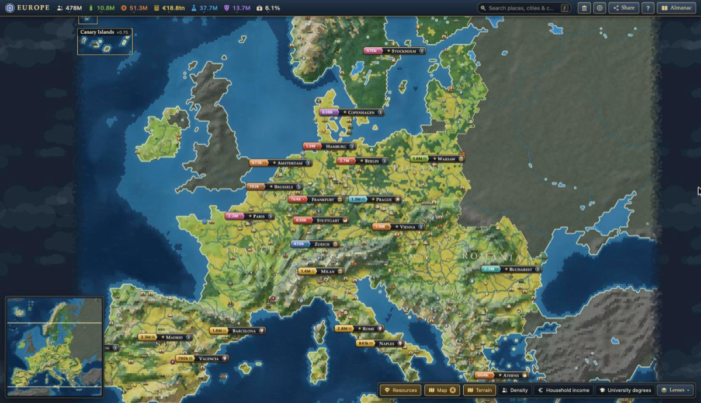

# Europe-Civilization (europeciv)

**Europe as a Civilization-style strategy map, built from open data.**
Play it at **[mathieuastruc.com/europeciv](https://mathieuastruc.com/europeciv/)** · [announcement on X](https://x.com/matheusnpu/status/2126047439274516570)



The 27 EU members, Iceland, Liechtenstein, Norway, Switzerland and the Western Balkans, drawn as a turn-based strategy
game map. It is a **port of [usaciv](https://karpathy.ai/usaciv/) by Andrej Karpathy** (MIT licence), through its French
port franceciv: the engine, the rendering and the interface come from usaciv; the data is rebuilt for Europe. This is a
first version, still being improved.

It is a viewer, not a game. Hex terrain comes from elevation and land cover. Cities are Eurostat's functional urban
areas, with yield banners drawn from GDP and jobs. There are lenses, a city view, a council of advisors, a daily
geography challenge and an Almanac that cites the source of every number.

## What is in it

- **The map.** About 71,000 hexes of 10 km radius (about 17 km across), 18,400 of them in the 37 countries: forests,
  farmland, heath and maquis, the snowy Alps and Pyrenees, wetlands, towns; rivers, lakes, neighbouring countries in
  the haze. The EU's outermost regions (Azores, Madeira, Canary Islands, Guadeloupe, Martinique, French Guiana,
  Réunion, Mayotte) sit in insets.
- **Countries and regions.** The map's "states" are the 37 countries, its "counties" the 1,265 NUTS 3 regions
  (Bosnia and Herzegovina: its three NUTS 2 entities).
- **Cities.** The 590 functional urban areas of the Urban Audit 2021 (a core city and its commuting zone), placed on
  their core city, plus towns of 50,000+ (GeoNames) in the countries the Urban Audit does not cover. Yields: Food,
  Production, Science and Culture are jobs by branch (Eurostat regional accounts, at the place of work); Gold is GDP.
  A city takes each NUTS 3 region's figures in proportion to the share of the region's people living in it (2021
  census local units).
- **Lenses.** Density, growth, median age, seniors, children, life expectancy, GDP per person (PPS), household income
  (PPS), poverty or social exclusion, unemployment, employment rate, university degrees, forest, farmland, built-up
  land, vineyards, olive groves, orchards.
- **Places.** The 98,000 local administrative units (communes, Gemeinden, comuni…) in the search box, with a card and
  a pin; Greek and Cyrillic names are transliterated.
- **Daily challenge.** Five places a day, the same for everyone, thirty seconds each: click where you think they are.
  1,000 points within 5 km, then fewer and fewer (about 680 at 100 km, 310 at 300 km). Rankings by player, city,
  country and part of Europe. The server (`server/api.py`, dependency-free Python and SQLite) draws the day's places
  with a secret key, sends one name at a time and reveals the answer only after the guess, timed on its own clock.

## Getting started

You need [uv](https://docs.astral.sh/uv/) (Python 3.11+, installed for you). Nothing else.

```bash
uv run python -m pipeline serve        # http://127.0.0.1:8765
uv run python -m pipeline package      # → europeciv.zip: the static site to host, and dist/europeciv-api
uv run python -m pipeline all          # download and rebuild all the data, then check it
uv run python -m unittest discover tests
```

`web/` is a self-contained static site (ES modules and Canvas 2D, no framework, no build step). The data pipeline uses
only Python's standard library. If your network intercepts TLS, export `SSL_CERT_FILE` to your system's certificate
store before `fetch`; if it resets TLS over IPv6, set `PIPELINE_IPV4=1`.

## How it is built

The flow is always **source → interim → builder → web/data**, as in usaciv:

- `pipeline/sources/`: one module per source, which downloads (with a cache and a provenance manifest) and tidies the
  data into `data/interim/`. GISCO (NUTS 2024, countries, Urban Audit 2021, LAU 2021), Eurostat (regional accounts,
  demography, labour force survey, Urban Audit), OpenGeoHub's 2018 land-cover map in CORINE classes (read by byte
  ranges from a cloud-optimised GeoTIFF), CORINE Land Cover for the French overseas regions, ETOPO1, Natural Earth,
  GeoNames.
- `pipeline/build/`: the builders that put those data on the hex grid and write `web/data/*.json`.
- `pipeline/check.py`: the consistency check of those files (`docs/DATA_CONTRACTS.md`).

The projection is a Lambert azimuthal equal-area centred on 52° N 10° E (the spherical form of EPSG:3035), scaled so
usaciv's art and camera, tuned for 25-unit hexes, keep their proportions: one map unit is 0.4 km (`world.json` →
`km_per_unit`).

## Data and credits

Code: MIT (see `LICENSE`; usaciv © Andrej Karpathy). Data, each with its own licence, cited file by file in the in-app
Almanac:

- Eurostat statistics and GISCO geography (NUTS 2024, Urban Audit 2021, LAU 2021): Eurostat reuse policy (CC BY 4.0);
  administrative boundaries © EuroGeographics.
- Land cover 2018 in CORINE classes and climate 2000-2019 (ERA5, CHELSA): OpenGeoHub EcoDataCube, CC BY 4.0, from
  Copernicus data; CORINE Land Cover 2018 for the French overseas regions (SDES / IGN, Licence Ouverte 2.0).
- Power plants: powerplantmatching (PyPSA, CC BY 4.0) and the WRI Global Power Plant Database (CC BY 4.0).
- World Heritage sites: UNESCO open data (CC BY-SA 4.0). Places: GeoNames (CC BY 4.0). Airports: OurAirports (public
  domain) with Eurostat traffic. Relief: NOAA ETOPO1 (public domain). Rivers, lakes, roads: Natural Earth (public domain).

## Security

The site is static; the only server part is the daily challenge (`server/api.py`): standard library only, bound to
127.0.0.1 behind a reverse proxy, with an origin check, per-address rate limits and a 4 kB body limit. Players have a
nickname and a random token, nothing else (no e-mail, no password). The challenge's secret key and database live only on
the server (`var/`, never in the repository), and the day's places are drawn from a pool (`web/data/defi.json`) that is
not published either. To report a vulnerability, see [SECURITY.md](SECURITY.md).
